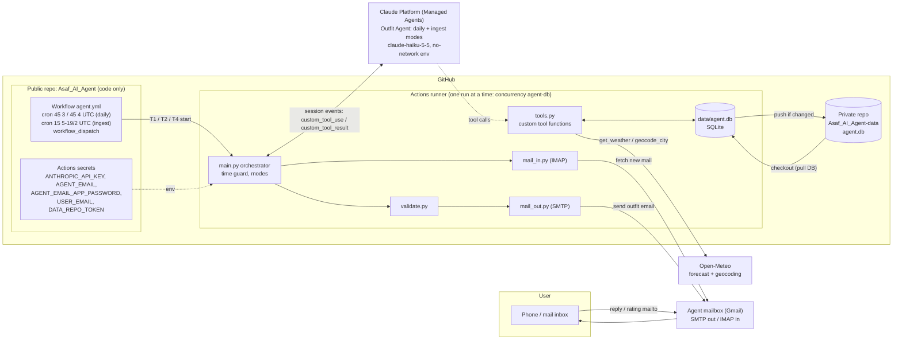
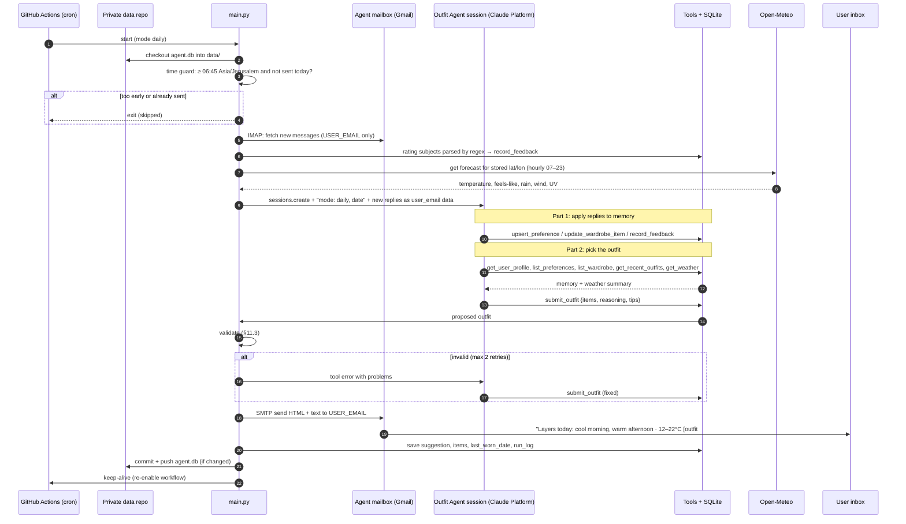
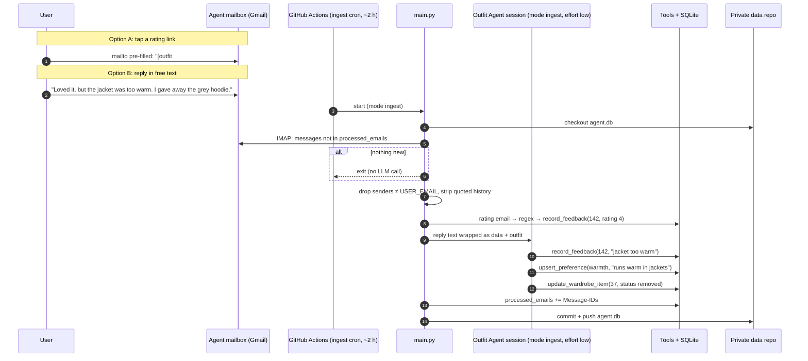
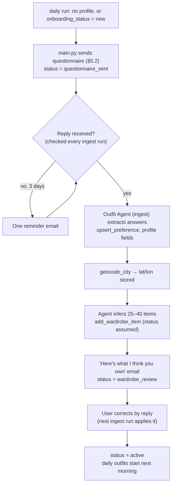
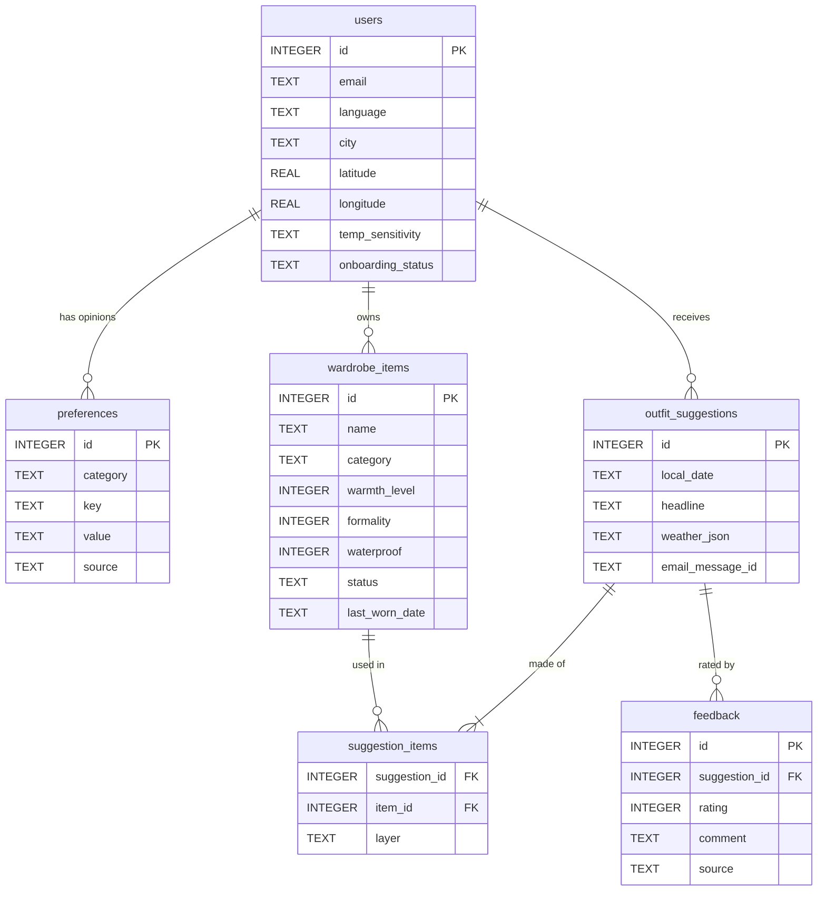
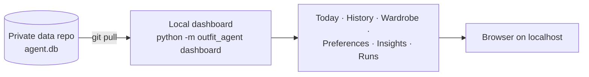

# Daily Outfit Agent — System Architecture

> Status: design only (the agent is not built yet) · 2026-10-19
> Follows [SPEC.md](SPEC.md) v1.2. Section references like "§9.1" point to SPEC.md.
> Platform: **Anthropic Claude Platform, Managed Agents.** One agent runs there: *Outfit Agent* (`agent_01MWduF1ekdbAGL3Yqq1hxyE`, `claude-haiku-5-5`, 13 custom tools) in environment `outfit-agent-env` (`env_011LPik3C15sqNt5a84848M8`). It has two run modes, `daily` and `ingest`. **GitHub Actions** triggers it and runs its custom tools.

This file answers three questions: **what triggers the agent, where its data comes from, and where its output goes.**

## 1. The short answer

### What triggers the agent?

| # | Trigger | Source | Mode it starts |
|---|---|---|---|
| T1 | **Every morning, ~07:00 Israel time.** Two cron entries, `45 3 * * *` and `45 4 * * *` UTC, plus a time guard: send only if local time ≥ 06:45 and nothing was sent today (§6, §9) | GitHub Actions `schedule` | `daily` |
| T2 | **About every 2 hours, 08:00–22:00 Israel time.** Cron `15 5-19/2 * * *` UTC (§9) | GitHub Actions `schedule` | `ingest`: reads new replies and ratings. Exits with no LLM call if the inbox has nothing new. |
| T3 | **First use.** `daily` finds no completed profile (§5.1) | Inside a `daily` run | `onboard`: sends the questionnaire |
| T4 | **Manual run** by a repo collaborator (§9) | GitHub Actions `workflow_dispatch` (`mode = daily / ingest / onboard`) | the chosen mode |

The user's replies and ⭐ ratings do **not** start a run themselves. They wait in the agent's mailbox until the next T2 or T1 run picks them up (within ~2 hours during the day).

### What happens to the agent's output?

In a `daily` run, the Outfit Agent finishes by calling the **`submit_outfit`** tool (§11.2) with item IDs by layer, reasoning, weather tips and an optional swap. Then plain Python code:

1. **Validates** it (§11.3): items owned and not removed, a bottom + shoes + top, no never-wear items, warmth suits the feels-like temperature, rain cover. Problems go back to the agent as a tool error, with up to 2 retries.
2. **Renders and emails** it via SMTP to `USER_EMAIL` (§12): HTML + plain text, mobile-first, with ⭐1–5 rating links and a "just reply" invitation. **This is the main output.** The user reads it on their phone at ~07:00 without asking.
3. **Saves** it in SQLite (§13): `outfit_suggestions`, `suggestion_items`, each item's `last_worn_date` and `run_log`.
4. **Persists** the DB by pushing `agent.db` to the private data repo (§9.1).
5. **Feeds it back**: the next runs read this outfit and the user's rating or reply through `get_recent_outfits`, so suggestions improve.

The LLM never chooses who gets an email. The orchestrator owns the clock, the mailbox and the recipient (§3).

## 2. System diagram

### 2.1 Components

| Component | Where | Responsibility | SPEC |
|---|---|---|---|
| **Workflow `agent.yml`** | Public repo | Schedules T1/T2, manual T4. `concurrency: agent-db`, `permissions: contents: read, actions: write`. Ends with the keep-alive step. | §9, §14.1 |
| **Orchestrator `main.py`** | Actions runner | Time guard, chooses the mode, runs the steps in order. Owns everything with side effects: clock, mail, recipient. | §3, §4, §6 |
| **Outfit Agent** | Claude Platform, defined in `agents/outfit-agent.md` (Haiku 5.5; effort `medium`, `low` for ingest sessions) | `daily`: applies new replies to memory, then reads profile, preferences, wardrobe, history and weather and calls `submit_outfit` once. `ingest`: applies new replies only; the orchestrator refuses `get_weather` / `submit_outfit` there. | §8, §11 |
| **Tools `tools.py`** | Actions runner | The only things the agents can do: read/write SQLite and call Open-Meteo. No email, no other network. | §7 |
| **Validator `validate.py`** | Actions runner | Code-side checks on the outfit before anything is sent | §11.3 |
| **Mail in/out** | Actions runner ↔ Gmail | IMAP fetch (allowlisted sender, dedupe by `Message-ID`); SMTP send with saved `Message-ID` | §8, §12 |
| **SQLite `agent.db`** | Runner, during a run | The memory: profile, preferences, wardrobe, outfits, feedback, processed emails, run log | §13 |
| **Private data repo** | GitHub (private) | Keeps `agent.db` between runs. Each run is a versioned backup. | §9.1 |
| **Open-Meteo** | SaaS (no key) | Geocoding once at onboarding, forecast every daily run | §10 |
| **Agent mailbox** | Dedicated Gmail account (App Password) | Sends the emails; receives replies and rating emails | §14 |

## 3. Data flow: daily run (T1)

**Why two crons:** Israel is UTC+3 in summer and UTC+2 in winter. In summer the 03:45 UTC run is 06:45 local and sends; in winter the 04:45 UTC run is 06:45 local and sends. The other run finds "already sent today" or "too early" and exits. If one run fails, the later one catches up. `UNIQUE (user_id, local_date)` guarantees one email per day.

## 4. Data flow: feedback (T2)

The next morning's daily run reads all of it through `get_recent_outfits` and `list_preferences`.

## 5. Data flow: first use / onboarding (T3)

## 6. Where data comes from and where it goes

| Data | Comes from | Stored in (SQLite table) | Used by |
|---|---|---|---|
| Profile: name, language, city, lat/lon, lifestyle, commute, temp sensitivity | Onboarding reply; `geocode_city` (Open-Meteo) | `users` | Outfit Agent (tone, location, temp adjustment); orchestrator (status) |
| Opinions / preferences | Onboarding, replies, feedback | `preferences` (`source` = onboarding / reply / feedback / inferred) | Outfit Agent, validator (`never_wear`) |
| Wardrobe | Agent inference (`assumed`), replies (`confirmed`, `removed`) | `wardrobe_items` | Outfit Agent, validator, email (item names) |
| Weather | Open-Meteo, every daily run | snapshot in `outfit_suggestions.weather_json` | Outfit Agent (live), history |
| Outfit suggestions | **Outfit Agent output** (`submit_outfit`) | `outfit_suggestions`, `suggestion_items` | Email, next runs (`get_recent_outfits`) |
| Ratings | Rating `mailto:` emails, parsed by regex | `feedback` (`rating_link`) | Outfit Agent (favour 4–5, avoid 1–2) |
| Free-text feedback | Email replies → Outfit Agent (Part 1) | `feedback` (`reply`), plus `preferences` / `wardrobe_items` | Outfit Agent |
| Processed mail IDs | IMAP `Message-ID` | `processed_emails` | Ingest (no double processing) |
| Run records | Orchestrator | `run_log` (mode, status, tokens, error) | Debugging, cost tracking |
| Secrets | Owner | GitHub Actions secrets, never in the repo | Orchestrator env only |

## 7. Database

Full DDL in §13. Relations:

`processed_emails` and `run_log` stand alone (no foreign keys).

## 8. Dashboard (planned, not in SPEC v1)

SPEC §18 lists a web dashboard as **out of scope for v1**. In v1 the daily email is the user's only view. A dashboard that respects SPEC's constraints, especially §14.1 (public repo, public Actions logs, nothing personal exposed), would be:

- **Local-only**: `python -m outfit_agent dashboard` pulls the private data repo and serves read-only pages on `localhost`. It is never deployed to GitHub Pages or anywhere public, because the data would become public.
- **Pages**: *Today* (outfit + weather), *History* (outfits with ratings), *Wardrobe* (assumed vs confirmed items), *Preferences* (with their source), *Insights* (rating trend, most/least worn items, rating vs feels-like temperature), *Runs* (from `run_log`: status, tokens, errors).
- **Read-only**: changes still go through email replies, so the agent's memory has a single write path.

Adopting this would mean moving it from §18 into the spec (a new milestone after §17 step 7).

## 9. Security & privacy (from §8, §14.1)

- **Public repo = code only.** `agent.db`, `.env` and personal fixtures are git-ignored. The DB lives in the private data repo, reached with a fine-grained token scoped to that repo only.
- **Public logs.** The code logs only counts and statuses, never email text, addresses, city, wardrobe or outfits. A test enforces this. `--dry-run` is refused inside Actions.
- **Triggers** are only `schedule` and `workflow_dispatch`. No `pull_request` or `pull_request_target`, so code from forks never sees secrets.
- **Agents act only through tools.** The tools touch SQLite and Open-Meteo, nothing else. Email sending and the recipient are fixed in code.
- **Prompt injection.** Only mail from `USER_EMAIL` is handled. Its text is passed to the Outfit Agent as data to extract facts from. The agent can only change the user's own memory. Because the same agent also picks the outfit, a crafted email could at worst steer that day's outfit, and the validator still limits it to owned, allowed items sent only to `USER_EMAIL`.

## 10. Failures, monitoring & cost (from §6, §9, §11.1)

| Failure | Reaction |
|---|---|
| Open-Meteo down (3 retries) | Email with a safe layered outfit and a "couldn't get the forecast" note |
| Claude error or `stop_reason == "refusal"` (Haiku 5.5 has no server-side fallback) | Short apology email; error in `run_log` |
| Outfit still invalid after 2 retries | Apology email; logged |
| Earlier cron run failed | The later cron run of the same morning catches up (time guard + "not sent today") |
| Scheduled workflow disabled after 60 days of repo inactivity | Prevented by the keep-alive step at the end of each daily run |

**Cost:** ~15–25K input + 2K output tokens per day on Haiku 5.5 ≈ **< $0.01/day**. GitHub Actions ~300 min/month is free for public repos. Open-Meteo and Gmail are free.
