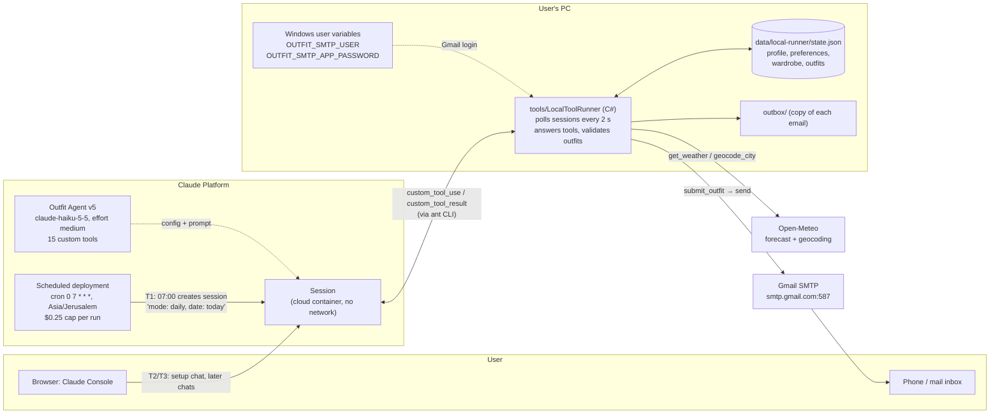
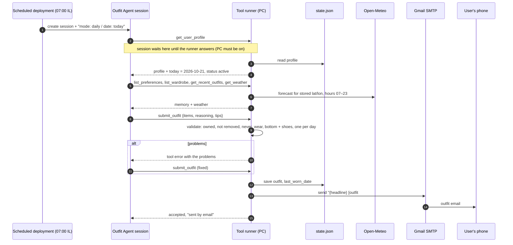
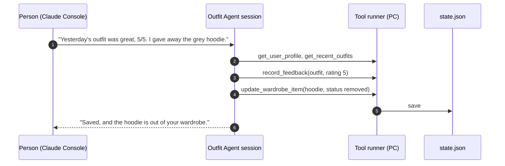
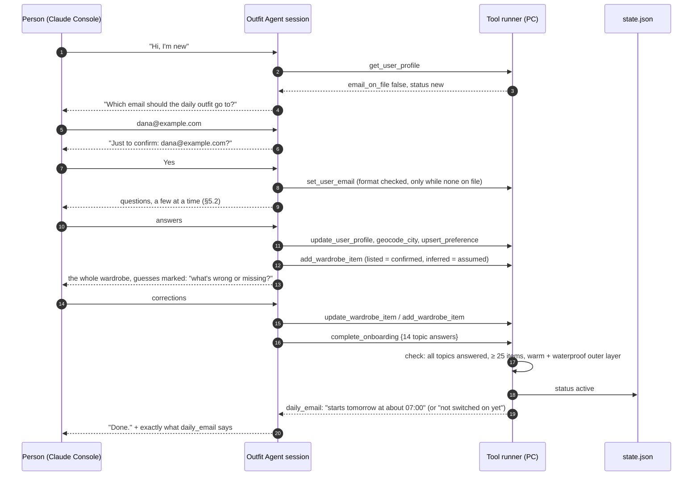
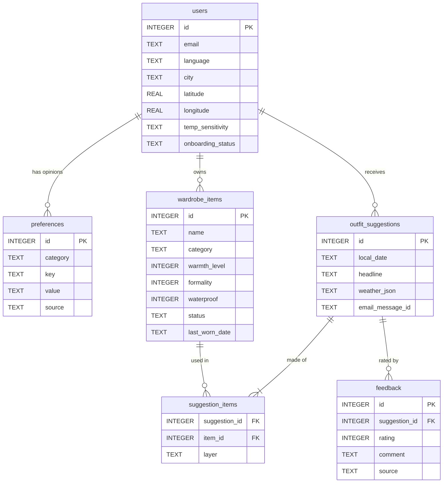
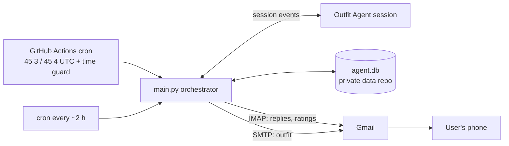

# Daily Outfit Agent — System Architecture

> Status: **stage A is live** · 2026-10-21
> Follows [SPEC.md](SPEC.md) v1.6. Section references like "§9.1" point to SPEC.md.
> Platform: **Anthropic Claude Platform, Managed Agents.** One agent: *Outfit Agent* (`agent_01MWduF1ekdbAGL3Yqq1hxyE`, version 5, `claude-haiku-5-5`, effort `medium`, 15 custom tools) in environment `outfit-agent-env` (`env_011LPik3C15sqNt5a84848M8`, no network). A **scheduled deployment** (`depl_01Y1QzXPprzAMfNy8nNzwNRf`) starts it every day at 07:00 Asia/Jerusalem. A **tool runner on the user's PC** (`tools/LocalToolRunner`) answers its tools and sends the outfit through Gmail.

This file answers three questions: **what triggers the agent, where its data comes from, and where its output goes.**

## 1. The short answer

### What triggers the agent?

| # | Trigger | Source | What runs |
|---|---|---|---|
| T1 | **Every morning at 07:00 Israel time** (Claude Platform may start it up to ~9 min late) | Claude Platform **scheduled deployment** `deployments/outfit-daily.yaml` (§9.1) | A `daily` session: message `mode: daily` / `date: today` → the agent picks today's outfit |
| T2 | **First use**: the person opens a session with the Outfit Agent in the **Claude Console** | The person, in the Console | The setup chat: email address, setup questions, wardrobe review, `complete_onboarding` (§5.1) |
| T3 | **Any later chat** in the Console | The person | The agent updates memory from what they say (feedback, new clothes, changed taste). It never sends an outfit from a chat. |
| T4 | **Manual test run**: `ant beta:deployments run --deployment-id depl_01Y1QzXPprzAMfNy8nNzwNRf` | Whoever maintains the agent | Same as T1, immediately |

Every session needs the **tool runner** on the PC: the agent's tools are custom tools, so a session waits at its first tool call until the runner answers. If the PC is off at 07:00, the email goes out when the runner is next started.

### What happens to the agent's output?

In a daily session the Outfit Agent finishes by calling **`submit_outfit`** (§11.2) with item IDs by layer, reasoning, weather tips and an optional swap. The tool runner then:

1. **Validates** it: every item owned and not removed, nothing matching `never_wear`, a bottom and shoes, and **only one outfit per day**. Problems go back to the agent as a tool error, and it fixes the outfit.
2. **Emails** it through Gmail SMTP to the address the person gave in the setup chat. **This is the main output**, and the only email the system sends: the user reads it on their phone in the morning without asking.
3. **Saves** it in `data/local-runner/state.json` and updates each item's `last_worn_date`. A copy goes to `data/local-runner/outbox/`.
4. **Feeds it back**: the next runs read it through `get_recent_outfits`, so the agent avoids repeats and learns from feedback.

The LLM never chooses who gets an email. The runner owns the clock, the recipient and the sending (§3).

## 2. System diagram

### 2.1 Components

| Component | Where | Responsibility | SPEC |
|---|---|---|---|
| **Outfit Agent** | Claude Platform, defined in `agents/outfit-agent.md` | Haiku 5.5, effort `medium`. Setup chat (Part 0), memory updates (Part 1), daily outfit (Part 2). Works only through its 15 custom tools. | §5, §7, §11 |
| **Environment `outfit-agent-env`** | Claude Platform, `environments/outfit-env.yaml` | Cloud container with **no network** (`allowed_hosts: []`). All real work happens in the tools. | §7 |
| **Scheduled deployment** | Claude Platform, `deployments/outfit-daily.yaml` | Creates the daily session at 07:00 Asia/Jerusalem, pinned to the agent version it was applied with, $0.25 cap per run | §9.1 |
| **Tool runner** | User's PC, `tools/LocalToolRunner` (.NET 9) | Finds idle sessions of the agent, answers each custom tool call, enforces the rules (no email → only email tools; not set up → no outfit; one outfit per day; complete wardrobe before setup ends), sends the email | §4, §6.1, §7 |
| **Memory** | User's PC, `data/local-runner/state.json` (git-ignored) | Profile (with the email and onboarding answers), preferences, wardrobe, outfits with feedback | §13 |
| **Gmail** | The agent's Gmail account, app password in Windows user variables | Sends the daily outfit, and nothing else | §12, §14 |
| **Open-Meteo** | SaaS, no key | Geocoding once in the setup chat, forecast every daily run | §10 |
| **`ant` CLI** | User's PC, signed in with `ant auth login` | Used by the runner to talk to Claude Platform, and by `ant apply` to sync the agent, environment and deployment files | §14 |

## 3. Data flow: daily run (T1)

## 4. Data flow: feedback (T3)

In stage A the agent doesn't read email. Feedback goes through a chat:

The next daily run reads all of it through `get_recent_outfits`, `list_preferences` and `list_wardrobe`. Reading email replies and rating links is planned for stage B (§8).

## 5. Data flow: first use / onboarding (T2)

Onboarding is **one chat on Claude Platform**: the person talks to the Outfit Agent in the Claude Console while the tool runner answers its tools. Nothing is emailed during setup; the first email is the first daily outfit.

If `complete_onboarding` is refused, the agent gets the reason (for example "only 11 items") and fixes it in the chat before trying again. While no email is on file, only `get_user_profile` and `set_user_email` work. Until the user is `active`, `get_weather` and `submit_outfit` are refused.

## 6. Where data comes from and where it goes

| Data | Comes from | Stored in | Used by |
|---|---|---|---|
| Email address | The person, in the setup chat (`set_user_email`) | `state.json` → `profile.email` (never shown to the agent) | Runner: recipient of the daily email |
| Profile: name, language, city, lat/lon, lifestyle, commute, temp sensitivity | Setup chat; `geocode_city` (Open-Meteo) | `profile` | Outfit Agent (tone, location, temperature adjustment) |
| Onboarding answers (one line per topic) | `complete_onboarding` | `profile.onboarding_answers` | Record of the setup |
| Opinions / preferences | Setup chat, later chats | `preferences` (with `source`) | Outfit Agent, validator (`never_wear`) |
| Wardrobe | Person (`confirmed`), agent's guesses (`assumed`), corrections (`removed`) | `wardrobe` | Outfit Agent, validator, email (item names) |
| Weather | Open-Meteo, every daily run | not stored | Outfit Agent |
| Outfit suggestions | **Outfit Agent output** (`submit_outfit`) | `outfits`, `outbox/` | Email, next runs (`get_recent_outfits`) |
| Feedback | Later chats (`record_feedback`) | `outfits[].feedback` | Outfit Agent |
| Run records | Claude Platform | Deployment runs and sessions (Console, `ant beta:deployment-runs list`) | Debugging, cost |
| Secrets | Owner | Windows user variables; `ant` login profile. Never in the repo. | Runner only |

## 7. Database

Stage A keeps everything in `state.json` (§13). Stage B moves it to SQLite with these relations (full DDL in §13):

## 8. Dashboard (planned, not in SPEC v1)

SPEC §18 lists a web dashboard as **out of scope for v1**; the daily email is the user's only view. A dashboard that respects §14.1 (public repo, nothing personal exposed) would be **local-only**: read `state.json` (stage A) or `agent.db` (stage B) and serve read-only pages on `localhost`. Pages: *Today*, *History* (outfits with ratings), *Wardrobe* (assumed vs confirmed), *Preferences* (with source), *Insights* (rating trend, most/least worn items), *Runs*. It is never deployed anywhere public, because the data would become public.

## 9. Stage B (planned): the PC can be off

Stage B keeps the same agent and moves the PC side to GitHub Actions (§6.2, §9.2, §9.3):

Differences from stage A: no PC needed, email replies and rating links are read (`ingest`), SQLite in a private data repo instead of `state.json`, a time guard and apology emails when something fails. The setup chat still happens in the Console, with `python -m outfit_agent tools` answering the tools.

## 10. Security & privacy

- **Public repo = code only.** `data/` (state, outbox, backups), `.env`, `bin/` and `obj/` are git-ignored. No personal data, email address or password is ever committed.
- **Secrets stay on the PC.** The Gmail app password lives in a Windows user variable. The runner never prints it, and the agent never sees it.
- **The agent has no network** and acts only through its tools. The tools touch `state.json` and Open-Meteo, and only `submit_outfit` leads to an email, sent by the runner to the one address on file.
- **The address comes only from the person** in the setup chat, after they confirm it, and the agent can't change it later.
- **Hard rules are enforced in code**, not only in the prompt: tool access by setup state, the 14 required topics, the minimum wardrobe, owned items only, `never_wear`, one outfit per day.

## 11. Failures, monitoring & cost

| Failure | What happens (stage A) |
|---|---|
| PC off or runner not running at 07:00 | The session waits at its first tool call. When the runner starts, it continues and the email goes out late (happened 2026-10-21: run at 07:08, email at 21:14). |
| Gmail variables missing or wrong | The runner saves the outfit to the outbox, reports "not sent" or the SMTP error in its tab, and the agent is told. |
| Open-Meteo down | `get_weather` returns an error; the agent submits a safe layered outfit and says the forecast was unavailable. |
| Invalid outfit | The runner returns the problems; the agent fixes and resubmits. |
| Second run on the same day | Refused: one outfit per day. |
| Deployment run fails to start | Recorded as a deployment run with an error (`ant beta:deployment-runs list`); the next day's run is unaffected. |

**Monitoring:** the runner's terminal tab shows every tool call and every email. The Claude Console shows each session's transcript and cost.

**Cost:** a daily run costs about $0.01–0.05 on Haiku 5.5 (the test run on 2026-10-20 cost about 1 cent of tokens), capped at $0.25 by the deployment. A setup chat cost about $0.05. Gmail and Open-Meteo are free.
